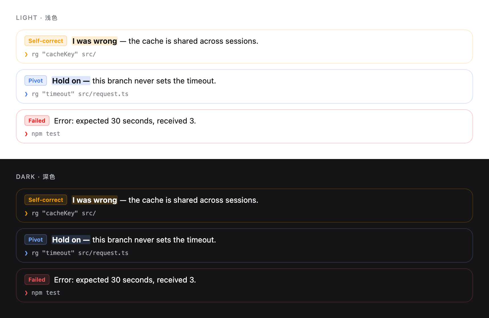

# CoT Keyframes

English · [简体中文](README.zh-CN.md)

A DeepSeek Harness plugin that surfaces key reasoning moments and their tool calls above the chat input.



*Component preview · Light and dark themes.*

- Highlights corrections, pivots, and discoveries in English and Chinese.
- Pairs each highlight with tool calls from the same step; surfaces tool failures.
- Follows the DSH theme and language. Hides when response text begins.
- Runs locally with keyword rules. No extra model calls.

## Install

Targets **DSH Desktop 0.2.1-rc.3**.

```sh
git clone https://github.com/cbccbcc/dsh-cot-keyframes.git
cd dsh-cot-keyframes
dsh plugin --profile desktop add "link:$PWD"
```

Build output is included; no `npm install` needed. Keep the cloned directory—DSH loads the plugin from it.

## Development

Edit `src/`, then build and test:

```sh
npm test
```

Restart DSH to load your changes. Signal rules live in [`src/core.mjs`](src/core.mjs).

## License

[MIT](LICENSE)
